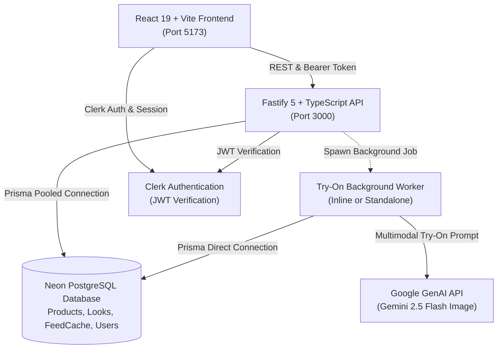

# FitChecker — Fashion Social & AI Virtual Try-On Platform

[](https://github.com/AnantAgarwal07/fitchecker)
[](https://github.com/AnantAgarwal07/fitchecker)
[](https://neon.tech)
[](https://fastify.dev)
[](https://react.dev)
[](https://ai.google.dev)
[](https://clerk.com)

**FitChecker** is an end-to-end social fashion platform and AI virtual try-on studio. Users upload reference photos and physical body measurements to generate an **anthropometric body MAP** (proportions and 2D skeletal landmarks—with **no heavy 3D mesh or custom model training needed**).

Discover runway looks, tag and inspect outfit hotspot pins linked to real catalog garments, test virtual try-ons with **Google Gemini 2.5 Flash Image**, and browse personalized recommendations cached with **sub-500ms latency**.

---

## 🌟 Key Features

- 👗 **Social Fashion Feed & Trending**: Community outfit sharing, tagged product hotspots, likes, comments, and exponential decay velocity ranking for trending looks.
- 🪄 **Multimodal Virtual Try-On Studio**:
  - **Live Mode**: Generates photorealistic try-on renders using Google's `@google/genai` (`gemini-2.5-flash-image`).
  - **Demo Mode**: Instant (< 1s) high-fidelity composite rendering with zero API quotas or network latency—ideal for local development, hackathons, and offline testing.
- ⚡ **Sub-500ms "For You" FeedCache**: Stale-while-revalidate caching system with precomputed fit scores, occasion filtering (Streetwear, Casual, Formal, Ethnic, Party, College), and background cache warming.
- 🔍 **Unified Search Engine**: Fast multi-tab search across Looks, Products, and Creators with debounced input and stale-response cancellation guards.
- 📐 **Anthropometric Ease Fit Engine**: Calibrates bust/chest, waist, and hip ease against garment sizing charts with personalized fit advice.
- 🔐 **Dual Auth Flow**: Seamless integration with **Clerk** authentication with automated fallback to guest demo mode for immediate evaluation without setup friction.

---

## 1. System Architecture



---

## 2. Core Subsystems

### 2.1 Virtual Try-On Pipeline & Worker
- **Two Execution Modes**:
  - `TRYON_MODE=demo` (Default): Instantaneous composite render (~500ms–1s). Guaranteed reliability for testing and review without API limits.
  - `TRYON_MODE=live`: Calls Google GenAI (`@google/genai` SDK) using `gemini-2.5-flash-image` with multimodal image/text prompts. Requires `GEMINI_API_KEY`.
- **Atomic Concurrency Lock (`claimJob`)**:
  Concurrency-safe database lock `updateMany({ where: { id, status: "QUEUED" }, data: { status: "PROCESSING", lockedAt, lockedBy, startedAt, attempts: { increment: 1 } } })`. Prevents duplicate processing across distributed workers.
- **Inline Worker for Local Dev (`INLINE_WORKER=true`)**:
  Processes background jobs via `setImmediate` within the main Fastify server process. No separate terminal required during local development.

### 2.2 High-Speed Personalized Recommender (`FeedCache`)
- **Composite Primary Key**: `@@id([userId, category])` storing precomputed match scores and fit notes `items: [{ postId, score, fitNote }]`.
- **Stale-While-Revalidate**:
  - **Fresh Cache Hit**: Returns in **< 500ms** (measured ~350–440ms server-side).
  - **Stale Cache Hit**: Returns existing cached feed immediately (`isStale: true`) while refreshing scores asynchronously.
  - **Cold Start**: Returns a curated starter feed immediately (`isStarter: true`) and calculates personalized rankings in the background.
- **Layout Stability**: Floating *"New picks available"* pill prevents content jumps when background updates complete.

### 2.3 Search Engine
- Server-side search across `/api/v1/posts?q=`, `/api/v1/trending?q=`, `/api/v1/for-you?q=`, `/api/v1/products?q=`, and `/api/v1/users/search?q=`.
- Case-insensitive matches across captions, hashtags, categories, creator usernames, and product brands.
- Debounced (300ms) with monotonic request ID guards to ignore superseded responses.

---

## 3. Tech Stack

| Domain | Technologies |
| :--- | :--- |
| **Frontend** | React 19, Vite, React Router 7, Clerk React, Vanilla CSS Design System |
| **Backend API** | Node.js (v20+), Fastify 5, TypeScript, Zod validation |
| **Database & ORM** | Neon Serverless PostgreSQL (Pooled + Direct connections), Prisma ORM |
| **AI / Multimodal** | Google GenAI SDK (`@google/genai`), Gemini 2.5 Flash Image |
| **Authentication** | Clerk (JWT verification) + Seamless Demo Guest fallback |
| **Testing** | Vitest, Supertest, Prisma Seed verification |
| **Deployment** | Docker, Render Blueprint (`render.yaml`) |

---

## 4. Environment Variables

### Frontend Configuration (`.env` in repository root)
| Variable | Required | Default | Description |
| :--- | :--- | :--- | :--- |
| `VITE_API_BASE_URL` | No | `http://localhost:3000` | Backend Fastify API base URL |
| `VITE_USE_MOCKS` | No | `false` | Fallback to client mocks if API is offline |
| `VITE_CLERK_PUBLISHABLE_KEY` | Optional | `""` | Clerk publishable key. If empty, falls back to demo mode |

### Backend Configuration (`server/.env`)
| Variable | Required | Default | Description |
| :--- | :--- | :--- | :--- |
| `DATABASE_URL` | **Yes** | — | Neon PostgreSQL connection string (pooled) |
| `DIRECT_URL` | Optional | — | Direct Neon connection string for migrations |
| `TEST_DATABASE_URL` | Optional | — | Dedicated test database connection string |
| `PORT` | No | `3000` | Fastify API server port |
| `NODE_ENV` | No | `development` | Environment (`development` or `production`) |
| `TRYON_MODE` | No | `demo` | `demo` for mock renders, `live` for Google Gemini |
| `GEMINI_API_KEY` | Optional | `""` | Required when `TRYON_MODE=live` |
| `GEMINI_IMAGE_MODEL`| No | `gemini-2.5-flash-image` | Model identifier for multimodal image generation |
| `INLINE_WORKER` | No | `true` | Process try-on jobs inside API server |
| `FEED_STALE_HOURS` | No | `6` | Expiry threshold for cached feeds |
| `DEBUG_TIMING` | No | `false` | Logs per-step query & scoring latency |
| `CLERK_SECRET_KEY` | Optional | `""` | Clerk backend secret key |
| `CLERK_PUBLISHABLE_KEY`| Optional| `""` | Clerk backend publishable key |
| `AUTH_DEMO_MODE` | No | `true` | Allows local development without Clerk |
| `CORS_ORIGINS` | No | `http://localhost:5173` | Comma-separated allowed origins |

---

## 5. Getting Started Locally

### Prerequisites
- Node.js `v20+` or `v22+`
- npm `10+`
- A free [Neon PostgreSQL](https://neon.tech) database

### Step 1: Clone & Install Dependencies
```bash
git clone https://github.com/AnantAgarwal07/fitchecker.git
cd fitchecker

# Install root & frontend dependencies
npm install

# Install backend dependencies
cd server && npm install && cd ..
```

### Step 2: Set Up Environment Files
```bash
# Frontend env
cp .env.example .env

# Backend env
cp server/.env.example server/.env
```
Open `server/.env` and paste your Neon PostgreSQL connection string into `DATABASE_URL`.

### Step 3: Run Database Migrations & Seed Data
```bash
# Generates Prisma client, runs schema migrations, and seeds catalog & feed cache
npm run server:seed
```

### Step 4: Start Development Servers
Open two terminal windows:

```bash
# Terminal 1: Backend Fastify API (Port 3000)
npm run server:dev

# Terminal 2: React 19 Frontend (Port 5173)
npm run dev
```

Visit [http://localhost:5173](http://localhost:5173) in your browser.

> [!TIP]
> To test the try-on pipeline with a standalone worker process instead of the inline worker:
> 1. Set `INLINE_WORKER=false` in `server/.env`
> 2. Run `cd server && npx tsx src/worker.ts` in a separate terminal.

---

## 6. Automated Testing

The project includes an extensive test suite verifying end-to-end functionality, security guards, cache latency, and algorithm edge cases:

```bash
npm run server:test
```

### Test Suite Overview (**77 tests passing across 8 suites**):
- **`phase5Search.test.ts` (10 tests)**: Query parameter verification across all endpoints, case-insensitivity, creator search, and empty state handling.
- **`phase4FeedCache.test.ts` (7 tests)**: Sub-500ms cache hit timing, stale-while-revalidate background refresh, starter feeds, category cache isolation, and profile update invalidation.
- **`integration.test.ts` (8 tests)**: Complete user lifecycle, outfit look uploads, product hotspot associations, like toggling, and try-on requests.
- **`phaseA.test.ts` (13 tests)**: Ownership checks (`/me`), private try-on session protections, signed photo upload consent, and worker concurrency safety.
- **`phaseB.test.ts` (11 tests)**: Anthropometric measurement validation and ease-based size match algorithms.
- **`phaseC.test.ts` (14 tests)**: Post discovery, creator follow graphs, wardrobe bookmarking, and feed diversification.
- **`tryOn.test.ts` (8 tests)**: Concurrency locking via `claimJob` and demo mode failure handling.
- **`scoring.test.ts` (6 tests)**: Match scoring heuristics and exponential decay velocity math.

---

## 7. API Reference

| Method | Endpoint | Description |
| :--- | :--- | :--- |
| `GET` | `/api/health` | Service health, database latency & memory stats |
| `GET` | `/api/v1/posts` | Fashion feed with product hotspots, tab, & search filters |
| `GET` | `/api/v1/trending` | Velocity-ranked trending fashion looks |
| `GET` | `/api/v1/for-you` | Personalized recommendation feed (sub-500ms `FeedCache`) |
| `GET` | `/api/v1/products` | Catalog search with category & wearability filters |
| `GET` | `/api/v1/products/:id/fit` | Specific ease & fit breakdown for user's body profile |
| `GET` | `/api/v1/users/search` | Search stylists and creators by name or handle |
| `POST` | `/api/v1/try-on` | Enqueue a virtual try-on session (`QUEUED`) |
| `GET` | `/api/v1/try-on/jobs/:jobId` | Poll try-on generation status & progress |
| `GET` | `/api/v1/try-on/sessions` | Fetch user's completed virtual try-ons |
| `PUT` | `/api/v1/try-on/sessions/:id` | Update try-on visibility (`PUBLIC` / `PRIVATE`) |
| `GET` | `/api/v1/users/me` | Fetch authenticated user profile & measurements |
| `PUT` | `/api/v1/users/:id/body-profile`| Update measurements (triggers feed recomputation) |

---

## 8. Deployment

A production-ready [Render Blueprint](render.yaml) is included in the repository:
1. **API Web Service (`fitsyou-api`)**: Fastify REST API running in a Docker container with health checks at `/api/health`.
2. **Background Worker (`fitsyou-tryon-worker`)**: Dedicated try-on queue consumer (`node dist/worker.js`).
3. **Frontend Static Site (`fitsyou-web`)**: Production-optimized Vite static site bundle.

Secrets such as `DATABASE_URL`, `CLERK_SECRET_KEY`, and `GEMINI_API_KEY` are safely configured via Render environment variables.

---

## 9. License

This project is licensed under the MIT License.
